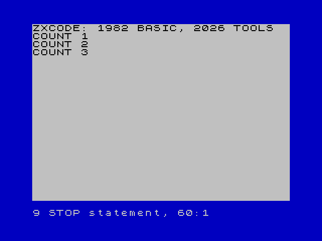

# M6 first external emulator: Fuse CLI

Decision: implement the first backend for the **Fuse command-line executable**.
The reproduced reference is Fuse 1.10.0 with libspectrum 1.7.0, built with SDL2 on
macOS arm64. A null-UI automation build of the same source provides captured ROM
execution evidence. The emulator is a test target; original Sinclair documents
and the ROM remain the definition of BASIC.

| Candidate | Relevant behavior | Decision |
| --- | --- | --- |
| Fuse | 48K target, explicit TAP/auto-load flags, owned process; reference launch reproduced. | First desktop adapter. |
| ZEsarUX | Broad machine support, CLI/configuration and remote debugging surface documented upstream. | Future adapter; its additional configuration/debug surface is not required for initial run. |
| SkoolKit 10.1 | Already pinned for headless original-ROM compatibility checks. | Keep as independent research target; it does not supply the desktop run window. |

Primary sources: [Fuse project](https://fuse-emulator.sourceforge.net/),
[manual](https://fuse-emulator.sourceforge.net/man/html/fuse.html),
[libspectrum](https://fuse-emulator.sourceforge.net/libspectrum.php),
[ZEsarUX project](https://github.com/chernandezba/zesarux).
Use the selected source distribution's `man/fuse.1`, `settings.dat`,
`compat/unix/paths.c` and `compat/win32/paths.c` for current implementation details;
the project website's HTML manual can lag its release.

## Reproduced launch and ownership

Invoke the executable directly with an argument array (each path is one argument):

```text
fuse --machine 48 --auto-load --no-autosave-settings --no-confirm-actions --no-sound --tape /absolute/program.tap
```

No shell, platform `open` command or file-association launcher is involved. The
SDL2 process remains running after the BASIC program stops and terminates when
explicitly stopped. Its exit is an emulator lifecycle event, not proof that BASIC
finished. Captured normal launch stayed alive for one second, then SIGTERM ended
it after exit confirmation was disabled; TAP bytes and the isolated settings file were unchanged. The default initial
adapter is silent for reproducible startup; sound UX can be added explicitly.

A TAP autostart line is needed for one-action execution. The research build used
`--autostart 10` through the existing CLI build API. Normal M5 Build still disables
autostart; M6-04 will document its separate run-artifact policy before changing
orchestration. The launch backend itself never edits the TAP/header.

Fuse reads configuration even for `--version`. On Unix CLI builds it uses
`$XDG_CONFIG_HOME/fuse-emulator/fuserc`, falling back to `~/.fuserc`. A private
XDG directory containing `<settings/>` prevents fallback to user preferences in
the tested libxml2 build. Keep `--no-autosave-settings` explicit.
`--no-confirm-actions` is also required: the default SDL2 quit confirmation kept
the first SIGTERM attempt alive until the bounded test killed that process.
A retry with confirmation disabled reproduced graceful stop. Win32 source uses
`%USERPROFILE%/fuse.cfg` and no fallback; its child environment/config path needs a
separate platform adapter. XML-less builds accept INI instead; first support must
handle that configuration format explicitly or report the unsupported variant.
Do not overwrite the user's Fuse configuration to make a run deterministic.

## Platforms, installation and fallback

The project supplies Unix source and Windows builds; it links a separate native
macOS port. The tested initial support is the common CLI/SDL2 build, not the Cocoa
app's file-open behavior. On Linux use the distribution's Fuse package or build
from official source. On macOS use a CLI/SDL2 build with libspectrum, SDL2 and its
ROM/data directory. On Windows use the direct `fuse.exe`, with its ROMs/data next
to it. Windows native launch/configuration remains unverified on this research
host; M6-03 isolates that variant and must not claim native execution evidence
from a simulated process test.

Provide an explicit executable path when PATH discovery fails. Validate a
candidate's `--version` identifies the Spectrum emulator, then launch the same
resolved executable. An application directory, wrapper that delegates/exits or
another program named Fuse is not a supported executable. Discovery must never
install software automatically or scan unrelated user directories.

Manual fallback: use **Build TAP**, open that file in an installed emulator,
select Spectrum 48K, issue `LOAD ""` if automatic loading is off, then `RUN` when
the tape has no autostart. This is useful even if a distribution's CLI differs;
it does not create a managed ZXCode run session.

## Distribution and research provenance

Fuse and libspectrum state GPL version 2 or later. ZXCode invokes a separately
installed executable; this ticket adds no emulator, linked library or ROM to the
VSIX/repository. Install/download from upstream or the user's package manager;
future bundling would need a separate distribution decision. No repository license
is invented by this selection.

Official source archive hashes used in the temporary research build:

- Fuse 1.10.0: `65b3ccc23c8b31fe779d1ff53edc260f776c0eafa93137df95803f14ba801b09`
- libspectrum 1.7.0: `b537942b2aab090d2a72fec8f58e597cc7a1f76d74c27c034665e4727f02109f`
- Bundled original 48K ROM: `d55daa439b673b0e3f5897f99ac37ecb45f974d1862b4dadb85dec34af99cb42`

Both builds used a private prefix and the existing glib/SDL2 libraries. Autoconf's
argument-length probe needed `lt_cv_sys_max_cmd_len=262144` in this sandbox; no
emulator source patch was made. The desktop configure flags were `--with-sdl
--without-gtk --enable-automation`; the capture build substituted `--with-null-ui`.
Development automation options are **not required** by the normal launch adapter.
Capture is currently provided by the null UI, not SDL2: asking the SDL2 build for
`--automation-capture-screen` reports a logical-framebuffer error. The reproduced
desktop bounded launch omitted capture and exited successfully.

`scripts/research/verify-fuse-launch.py` reproduces direct desktop launch/stop or,
with `--capture`, a bounded null-UI execution. It checks target, TAP CRC, autoload,
artifact capture, unchanged tape and unchanged private configuration. It remains
optional research, outside ordinary CI. The checked-in evidence records hashes
and the captured screen; binary source archives/ROMs remain outside the repository.


